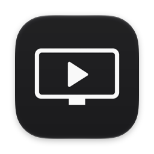

<p align="center"></p>

# CapView

캡처보드(닌텐도 스위치 2, PS5 등)의 화면과 소리만 띄우는 아주 가벼운 macOS 뷰어입니다.
OBS의 방송·녹화·장면 기능은 전부 빼고, "보면서 게임하기"에 필요한 것만 남겼습니다. (앱 크기 1 MB 미만)

## 다운로드와 설치

1. [Releases](../../releases/latest)에서 `CapView-x.y.z-macOS.zip`을 받아 압축을 풉니다.
2. `CapView.app`을 `응용 프로그램`(Applications) 폴더로 옮깁니다.
3. 처음 한 번만: 앱을 열면 "Apple이 악성 코드가 없음을 확인할 수 없습니다"라는 경고가 뜹니다.
   (유료 Apple 개발자 공증을 받지 않은 개인 프로젝트라서 그렇습니다.)
   **시스템 설정 › 개인정보 보호 및 보안**으로 가서 아래쪽의 **"그래도 열기"**를 누르고, 다시 열 때 **"열기"**를 누르세요.
   (터미널에 익숙하다면 `xattr -dr com.apple.quarantine /Applications/CapView.app` 한 줄로도 됩니다.)
4. 카메라·마이크 권한을 묻으면 **허용**합니다. (캡처보드는 macOS에서 카메라/마이크로 취급됩니다)

요구 사항: macOS 15 이상, Apple Silicon 또는 Intel Mac, UVC 방식 USB 캡처보드.

## 기능

- 캡처보드 자동 인식, 영상은 원본 비율 그대로(레터박스) 표시
- 같은 캡처보드의 오디오 입력을 자동으로 짝지어 재생 (USB VID/PID 또는 이름으로 매칭)
- 저지연: 영상은 도착 즉시 표시(큐 없음, 복사 없음), 소리는 약 20 ms 지연 (유선 헤드셋·스피커 기준, 블루투스 이어폰은 기기 자체 지연이 100 ms 이상)
- 해상도 / 프레임레이트 선택 (기본: 60 fps 이상을 낼 수 있는 가장 큰 해상도, 59.94 fps도 선택 가능)
- 화면 캡처 (`⌘C` 또는 오른쪽 클릭 › 화면 캡처): 지금 화면을 클립보드에 복사해서 카카오톡·디스코드 등에 바로 붙여넣기
- 화면 조정 (`⌘E` 또는 오른쪽 클릭 › 화면 조정…): 밝기·대비·채도·감마·색조를 실시간으로 보면서 조절, "색 범위 확장"으로 회색빛으로 뿌연 화면 보정
- 창 비율 고정, 더블클릭 전체 화면, 항상 위에 표시
- 2초간 마우스를 움직이지 않으면 커서와 창 버튼 숨김
- 게임 중 디스플레이 잠자기 방지 (컨트롤러만 쓰면 Mac은 입력이 없다고 판단하기 때문). 영상이 5분 넘게 안 들어오면 다시 잠자기 허용
- 한 번 쓴 캡처보드를 기억하고, 뽑았다 꽂으면 자동 재연결 (다른 카메라로 멋대로 바꾸지 않음). 영상이 멈추면 자동 복구
- 출력 장치를 바꾸면(헤드셋 ↔ 스피커) 소리가 자동으로 따라감
- 설정(장치, 해상도, 볼륨 등)은 다음 실행 때도 유지

## 직접 빌드하기

요구 사항: macOS 15 이상, Xcode 26 이상 (오디오 엔진의 실시간 안전성 컴파일 검사에 필요).

```bash
./scripts/build-app.sh
open build/CapView.app
```

`/Applications`에 설치(또는 업데이트)하려면:

```bash
./scripts/build-app.sh install
```

실행 중인 CapView를 종료하고 기존 앱을 지운 뒤 새로 복사합니다. 실행 중인 앱 위에 `cp`로 덮어쓰면 서명 검사에 걸려 강제 종료될 수 있으니 이 방법을 쓰세요.

첫 실행 때 카메라·마이크 권한을 묻습니다. 캡처보드는 macOS에서 "카메라/마이크"로 취급되므로 둘 다 허용해야 합니다.
실행 중에는 메뉴 막대에 주황색 마이크 표시가 보이는데, 캡처보드 소리를 받고 있다는 뜻입니다.

### 권한과 서명

`build-app.sh`는 키체인에 "Apple Development" 인증서가 있으면 그것으로 서명합니다. 같은 인증서로 서명하면 다시 빌드해도 권한이 유지됩니다.
인증서가 없으면 ad-hoc 서명을 쓰는데, 이 경우 빌드할 때마다 권한을 다시 물을 수 있습니다.
무료 Apple 계정으로도 Xcode › 설정 › Accounts에서 계정을 추가하고 "Manage Certificates…"에서 Apple Development 인증서를 만들 수 있습니다.
(무료 인증서는 1년 뒤 만료됩니다. 만료되면 같은 방법으로 새로 만들고 다시 빌드하면 되고, 권한은 한 번 더 물어볼 수 있습니다.)

권한을 거부했거나 꼬였다면 초기화한 뒤 앱을 다시 실행하세요:

```bash
tccutil reset Camera com.ycs.capview
```

```bash
tccutil reset Microphone com.ycs.capview
```

앱은 하드닝된 런타임(hardened runtime)과 카메라·오디오 입력 entitlement로 서명되므로, 나중에 공증(notarization)해서 다른 사람에게 배포할 때도 그대로 쓸 수 있습니다.

## 단축키

| 키 | 동작 |
|---|---|
| 더블클릭, `F`, `⌃⌘F` | 전체 화면 전환 (`Esc`로 나가기) |
| `M` | 음소거 |
| `↑` / `↓` | 볼륨 10% 올리기 / 내리기 |
| `⌘T` | 항상 위에 표시 |
| `⌘0` | 실제 픽셀 크기 (1080p 영상 = 화면 픽셀 1:1, 디스플레이가 기본 배율일 때) |
| `⌘C` | 화면 캡처 (클립보드에 복사) |
| `⌘E` | 화면 조정 창 열기 |
| `⌘R` | 장치 다시 연결 |
| 오른쪽 클릭 | 장치·해상도·오디오 메뉴 |

`F`·`M`·방향키는 한글 입력 상태에서도 동작합니다. 비디오 메뉴에는 실제로 들어오는 프레임 수(측정 fps)가, 오디오 메뉴에는 예상 오디오 지연과 끊김 횟수가 표시됩니다.

## 문제 해결

**소리가 몇 초마다 툭툭 끊긴다 / 오디오 메뉴에 "캡처보드 … 회" 끊김이 늘어난다**
캡처보드의 USB 오디오 전송 자체가 실패하는 경우입니다(macOS가 USB 오디오 스트림을 재시작하며 약 0.25초 소리가 비어요).
OBS에서도 똑같이 생기는 하드웨어/연결 문제라 앱이 메울 수 없습니다. 대부분 USB 허브나 모니터·도크의 USB 포트를 거칠 때 생기니,
캡처보드를 **Mac 본체의 USB-C/USB-A 포트에 직접** 연결하고 다른 케이블도 시험해 보세요.

**화면이 검게 나오거나 "영상이 들어오지 않습니다"가 뜬다**
게임기 전원과 HDMI 연결을 확인하세요. PS5는 HDCP가 켜져 있으면 캡처가 막히므로 설정 › 시스템 › HDMI › "HDCP 활성화"를 꺼야 합니다
(PS4는 설정 › 시스템 › "HDCP 활성화"). 이 설정을 끄면 PlayStation에서 일부 동영상 앱이 재생되지 않을 수 있습니다.
스위치 2는 캡처보드가 받을 수 있는 1080p 60Hz로 출력되도록 해 주세요.

**십몇 초마다 화면이 한 번씩 미세하게 끊긴다**
게임기 출력(60 / 59.94 Hz)과 캡처 프레임레이트가 어긋나면 약 17초마다 프레임이 한 장 겹치거나 빠집니다.
비디오 › 프레임레이트에서 60과 59.94를 바꿔 보세요. Mac 모니터의 재생률(시스템 설정 › 디스플레이 › 재생률)도 60 Hz 계열인지 확인하세요.

**화면이 회색빛으로 뿌옇거나, 반대로 어두운 부분이 뭉개진다**
게임기와 캡처보드가 RGB 범위(제한/전체)를 다르게 알고 있을 때 생깁니다. 먼저 게임기 설정에서 RGB 범위를 "자동" 또는 "제한"으로 맞춰 보고,
그래도 뿌옇다면 화면 조정 › "색 범위 확장"을 켜세요.

**HDR은 지원하나요?**
아니요. 대부분의 USB 캡처보드(이 앱을 만든 GC311G2 포함)는 HDR을 TV로 통과시킬 뿐, 캡처는 8비트 SDR로만 합니다.
게임기에서 HDR을 켜면 캡처 화면이 뿌옇게 보일 수 있으니, 캡처해서 볼 때는 게임기의 HDR을 끄는 것을 권장합니다.

**OBS와 같이 켜 두면 해상도/프레임레이트를 바꿀 수 없다**
OBS가 장치 설정을 잠그고 있어서입니다. OBS를 끄면 CapView 설정이 적용됩니다.

## 구조

| 파일 | 역할 |
|---|---|
| `VideoCapture.swift` | `AVCaptureSession` → `AVSampleBufferDisplayLayer` (도착 즉시 표시), 포맷/프레임레이트 선택 |
| `PassthroughCore/` (C) | 실시간 오디오 엔진: 입력 AUHAL → 링 버퍼 → Varispeed(샘플레이트 변환 + 클럭 드리프트 보정) → 출력 AUHAL |
| `AudioPassthrough.swift` | 오디오 엔진 설정, 출력 장치 변경·슬립 복귀 대응, 지연 추정 |
| `AudioDevices.swift` | Core Audio 장치 목록/속성 헬퍼 |
| `DevicePairing.swift` | 비디오 장치와 같은 캡처보드의 오디오 입력 찾기 |
| `PlayerWindowController.swift` | 창, 비율 고정, 전체 화면, 커서/버튼 자동 숨김 |
| `PictureAdjustments.swift` | 화면 조정 창과 Core Image 필터 (밝기·대비·채도·감마·색조·색 범위) |
| `AppController.swift` | 장치 선택, 핫플러그, 프레임 감시, 메뉴, 단축키 |
| `DisplaySleepBlocker.swift` | 디스플레이 잠자기 방지 |
| `Prefs.swift` | 설정 저장 (`UserDefaults`) |

오디오 콜백은 Core Audio의 실시간 스레드에서 돌기 때문에 C로 작성했고, `-Werror=function-effects`로 빌드해서
콜백 안에서 메모리 할당이나 락을 쓰면 컴파일이 실패하도록 했습니다.

OBS 코드는 사용하지 않았습니다(OBS는 GPL 라이선스). 같은 macOS API(AVFoundation, Core Audio)를 직접 호출하는 독립 구현입니다.

## 배포용 빌드

```bash
./scripts/build-app.sh dist
```

Apple Silicon·Intel 겸용(universal) 앱을 만들고, 개인 인증서 대신 ad-hoc 서명을 한 뒤 `build/CapView-<버전>-macOS.zip`으로 묶습니다.
이 zip을 GitHub Release에 올리면 됩니다.

## 라이선스

MIT. 자세한 내용은 [LICENSE](LICENSE)를 보세요.
